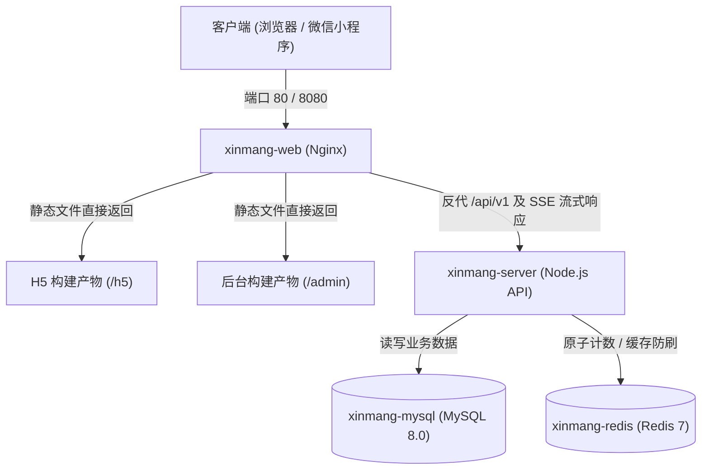

# 《心芒灵境》云服务器部署与代码更新运维手册

本手册记录了《心芒灵境》全栈项目在生产云服务器（阿里云 ECS）上的环境架构、服务访问地址、自动化更新方法及常用运维指令。

---

## 一、生产服务器基本信息

| 配置项 | 说明 / 参数值 |
| :--- | :--- |
| **服务器公网 IP** | `8.148.201.178` |
| **SSH 登录端口** | `22` (默认) |
| **登录用户 / 密码** | `root` / `Aa123456` |
| **项目服务器根目录** | `/opt/xinmang-lingjing` |
| **部署架构方案** | **Docker Compose 容器化全栈集群** (含独立持久化存储卷) |
| **虚拟内存保障** | 已配置并启用永久 **2GB Swap**，杜绝突发内存溢出 (OOM) |

---

## 二、生产环境服务访问地址

| 服务模块 | 公网访问地址 | 默认账号 / 状态 |
| :--- | :--- | :--- |
| 🔮 **心芒灵境 · H5 客户端** | [http://8.148.201.178/](http://8.148.201.178/) | 微信小程序 H5 网页版（已适配大模型 SSE 流式打字） |
| 💻 **Web 运营管理后台** | [http://8.148.201.178:8080/](http://8.148.201.178:8080/) | 账号：`admin` / 密码：`admin123` |
| 🩺 **后端健康检查与状态探针** | [http://8.148.201.178:3000/health](http://8.148.201.178:3000/health) | 实时返回 MySQL & Redis 驱动与健康状态 |
| 🎴 **权威卡牌资产 API** | [http://8.148.201.178:3000/api/v1/tarot/cards](http://8.148.201.178:3000/api/v1/tarot/cards) | 78 张卡牌全量心理资产与页面 OSS 映射 |

> [!IMPORTANT]
> **阿里云安全组端口开放规则**：
> 请确保在阿里云 ECS 控制台安全组入方向已放行：
> - `80/80`（H5 网页访问）
> - `8080/8080`（管理后台访问）
> - `3000/3000`（后端 API 服务访问）

---

## 三、Docker 容器集群架构

所有服务均已设置为**开机自启**（`restart: always`），并通过 Docker Compose 统一编排调度：



| 容器名称 | 基础镜像 | 映射端口 | 容器内用途 | 内存占用 |
| :--- | :--- | :--- | :--- | :--- |
| **`xinmang-web`** | `nginx:alpine` | `80`, `8080` | 动静分离分发 H5 与管理后台，中转 API 并优化 SSE 流式打字 | ~3.4 MB |
| **`xinmang-server`** | 自建生产镜像 | `3000` | Node.js + Express + Prisma 核心业务逻辑 | ~25.5 MB |
| **`xinmang-mysql`** | `mysql:8.0` | `127.0.0.1:3306` | MySQL 8.0 业务数据库，持久化挂载至宿主机 `mysql_data` | ~123 MB |
| **`xinmang-redis`** | `redis:7-alpine` | `127.0.0.1:6379` | 高速缓存、分布式锁与每日防刷原子计数，持久化挂载至 `redis_data` | ~3.4 MB |

> [!TIP]
> **数据持久化安全保障**：
> MySQL 与 Redis 的全部历史数据均独立存储于 Docker 宿主机持久化卷（`mysql_data` 和 `redis_data`）中。**无论更新代码、重建镜像或重启服务器，数据库中的数据绝不会丢失！**

---

## 四、后续更新代码的最佳实践

### 方案 A：本地一键极速更新（推荐）

在本地项目根目录下，直接执行我们为您准备的自动化脚本 [`update-server.sh`](file:///Users/clao/心芒灵境/update-server.sh)：

```bash
# 全量更新（自动编译前端 -> 打包上传 -> 平滑热重载 Nginx -> 增量重建后端容器）
./update-server.sh
```

#### 支持指定子模块快速更新（耗时仅 3~5 秒）：
```bash
./update-server.sh h5      # 仅更新 H5 小程序网页版
./update-server.sh admin   # 仅更新 运营管理后台
./update-server.sh front   # 同时更新 H5 与管理后台（不重启后端容器）
```

---

### 方案 B：手动分场景更新

如果您希望在本地或服务器上手动精准控制每一步更新：

#### 场景 1：仅修改了前端页面（H5 或后台界面）
前端由 Nginx 挂载提供服务，**完全不需要重启任何 Docker 容器**。
```bash
# 1. 本地打包
cd miniprogram && npm run build:h5 && cd ..
cd admin && npm run build && cd ..

# 2. 上传覆盖到服务器
scp -r miniprogram/dist/build/h5 root@8.148.201.178:/opt/xinmang-lingjing/miniprogram/dist/build/
scp -r admin/dist root@8.148.201.178:/opt/xinmang-lingjing/admin/

# 3. 在服务器上热重载 Nginx (秒级生效)
ssh root@8.148.201.178 "docker exec xinmang-web nginx -s reload"
```

#### 场景 2：仅修改了后端接口逻辑（`server/src/`）
```bash
# 1. 上传更新的后端源码
scp -r server/src root@8.148.201.178:/opt/xinmang-lingjing/server/

# 2. 登录服务器并增量重建后端容器 (MySQL 和 Redis 容器保持运行不受影响)
ssh root@8.148.201.178
cd /opt/xinmang-lingjing
docker compose up -d --build server
```

#### 场景 3：修改了数据库模型（`prisma/schema.prisma`）
```bash
# 1. 上传修改后的 schema
scp server/prisma/schema.prisma root@8.148.201.178:/opt/xinmang-lingjing/server/prisma/

# 2. 在容器内部推送结构更新并重启 server
ssh root@8.148.201.178
docker exec -it xinmang-server npx prisma db push --skip-generate --accept-data-loss
docker compose restart server
```

---

### 方案 C：基于 Git 仓库同步工作流

如果您在团队协同中使用了 GitHub / Gitee 私有仓库：
```bash
# 1. 本地提交并推送到代码仓
git add .
git commit -m "feat: 业务功能更新"
git push origin main

# 2. 登录服务器拉取最新代码并生效
ssh root@8.148.201.178
cd /opt/xinmang-lingjing
git pull origin main
docker compose up -d --build server
docker exec xinmang-web nginx -s reload
```

---

## 五、常用线上运维与日志排查速查表

所有命令在登录云服务器终端（`ssh root@8.148.201.178`）后执行：

```bash
# 1. 查看所有微服务容器运行状态
docker ps

# 2. 查看各容器资源占用 (CPU / 内存)
docker stats --no-stream

# 3. 跟踪查看后端实时日志（包括 API 请求和大模型 SSE 流式输出）
docker logs -f --tail 100 xinmang-server

# 4. 跟踪查看 Nginx 访问与反向代理日志
docker logs -f --tail 100 xinmang-web

# 5. 单独重启某个服务
docker restart xinmang-server  # 重启后端
docker restart xinmang-web     # 重启 Web 网关
docker restart xinmang-mysql   # 重启数据库
docker restart xinmang-redis   # 重启缓存

# 6. 进入 MySQL 命令行直接查询数据
docker exec -it xinmang-mysql mysql -uroot -pAa123456 xinmang_lingjing

# 7. 进入 Redis 命令行检查键值
docker exec -it xinmang-redis redis-cli

# 8. 查看服务器整体内存与磁盘健康状态
free -m
df -h
```
